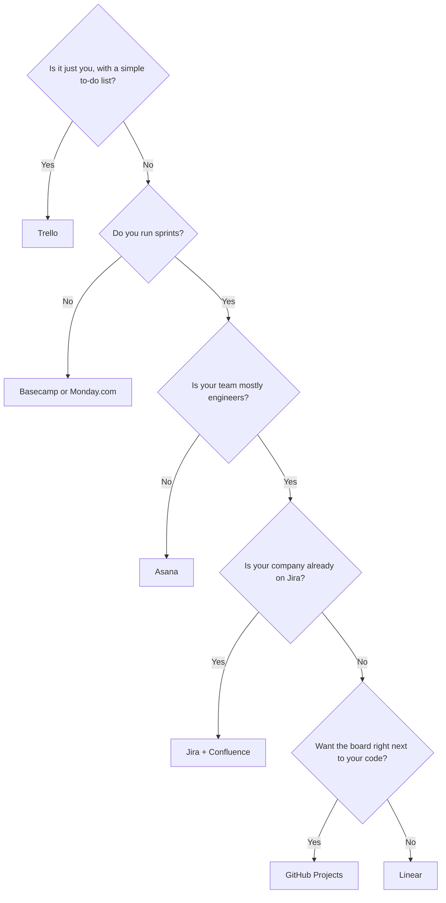

# Tools I use to build apps

*Updated Nov 2026*

These are the tools I use and recommend for building apps and running product work: project management, product management and productivity. I made this list because people kept asking what I use, and a long list of logos doesn't help you pick. So it starts with what you're trying to do, then gives you a few stacks that work together, a real build of mine, and the full list with when to skip each tool.

Every tool has a level:

| Level | What it means |
|---|---|
| **Beginner** | No code needed. Sign up and start. |
| **Intermediate** | Some setup or technical comfort needed. |
| **Advanced** | You write or wire up code. |

## Start by what you're trying to do

### I have an idea and want to test it

- **Claude Cowork** (Beginner): brainstorm the idea, poke holes in it and write the plan, right next to your files.
- **Lovable** (Beginner): turn a prompt into a prototype you can show people.
- **Claude Design** (Beginner): get the screens looking right from a prompt before you build anything.
- **Tally** (Beginner): put up a quick form to see if people actually want it.

### I want to build a working prototype

- **Lovable** (Beginner): the fastest way from prompt to a working app, no code.
- **Claude Code** (Advanced): when you want the real code in your own folder and full control.
- **Cursor** (Advanced): when you want to read and edit the code alongside the AI.
- **Figma** (Intermediate): when the design has to be right before anyone builds it.

### I'm running a team or sprints

- **Asana** (Beginner): sprints and backlog tickets without needing to be technical.
- **Linear** (Intermediate): fast sprints for product and engineering, and it connects to GitHub.
- **Jira** (Intermediate): if you're at a bigger company, you'll probably end up here.
- **Slack** (Beginner): somewhere for the team to talk that isn't email.

### I want to know if people use my app

- **PostHog** (Intermediate): analytics, session replay, feature flags and experiments in one place.
- **Microsoft Clarity** (Beginner): free heatmaps and session replay to see where people get stuck.
- **Mixpanel** (Intermediate): funnels, so you can see exactly where people drop off.
- **Amplitude** (Intermediate): retention, so you know if people come back.

### I'm doing user research

- **Granola** (Beginner): notes from your interviews without a bot joining the call.
- **Dovetail** (Intermediate): one home for all your research so it doesn't get lost.
- **Maze** (Intermediate): test your prototype with people without having to run every session.
- **NotebookLM** (Beginner): ask questions across your own interview notes and sources.

### I want to stop doing busywork

- **Zapier / Make** (Beginner): connect your apps so the boring steps happen on their own.
- **Calendly** (Beginner): stop going back and forth about times.
- **n8n** (Advanced): build automations with AI steps when Zapier isn't enough.
- **Claude API + MCP** (Advanced): build your own agent that works with your tools.

## Starter stacks

Three combos that work well together. Pick the one closest to where you are now.

### Free stack for your first app

Every tool here has a free plan or free tier as of Nov 2026.

| Tool | What it does in this stack | Level |
|---|---|---|
| Claude | Plan the idea and write what the app should do | Beginner |
| Lovable | Build the prototype from that plan | Beginner |
| Tally | A sign-up or feedback form to share with people | Beginner |
| PostHog | See who uses it and what they click | Intermediate |

### Solo builder stack

| Tool | What it does in this stack | Level |
|---|---|---|
| Claude Cowork | Brainstorm the idea and write the spec | Beginner |
| Claude Design | Turn the spec into design specs and screens | Beginner |
| Claude Code | Build the real app from the spec, in your own folder | Advanced |
| Linear | Track what's next, one sprint at a time | Intermediate |
| PostHog | Measure what people actually do once it's live | Intermediate |

### Small team stack

| Tool | What it does in this stack | Level |
|---|---|---|
| Asana | Sprints, backlog and who's doing what | Beginner |
| Notion | Specs, docs and the team wiki | Beginner |
| Slack | Day-to-day team chat | Beginner |
| Figma | Design and prototypes everyone can comment on | Intermediate |
| PostHog | One place for analytics, replays and feature flags | Intermediate |

## A real walkthrough: an iPhone app prototype in one evening

**Can I afford this?** is a budget app prototype I built for iPhone in one evening. I tried the budgeting apps everyone recommends, and none of them fit how I actually spend, so I made my own and filmed it for a short video. You ask it before you buy something, and it checks your bank balance and the bills coming up. Everything in it is made-up demo data, and the smart parts are simulated for now. It's not financial advice.

**Tools in this build:** Claude Cowork for the plan and the mocks, Claude Code for the build, Expo and Expo Go to run it on my iPhone, and Apple's SF Symbols for icons.

**How I usually build:** I brainstorm in Claude Cowork, do the design specs in Claude Design, then build in Claude Code. Depending on the build, I'll skip a step. For this one, Cowork handled both the plan and the mocks.

### Part 1: the plan, in Cowork

1. **I started with what the video had to show.** Four moments: Can I afford this?, sinking funds (money split into pots that carry over), what's due on each card, and a monthly check-in. Everything else is built around those four.

2. **I wrote the spec with Claude in Cowork.** It's a `CLAUDE.md` file that Claude Code reads every time it starts, so I never re-explain the app. It covers the scope, the stack, every screen, the colours and type, the copy rules, the answer logic and the build order. It more than doubled in size over a few rewrites before any code got written.

3. **I designed the screens in the same place.** Nine phone frames in one `mocks.html` file, over seven rounds. I wanted it soft and calm, not like a bank app: cream, white cards, black text and a honey accent, with Apple's text styles, fonts I already use and my own spacing system. My rule for Claude: the mocks win for looks and the spec wins for logic.

4. **I switched from a web app to a real iPhone app.** The first spec was a phone-first web app with Next.js and real Claude API calls. Right before building, I changed it to a native iPhone app with Expo, React Native and TypeScript, because I wanted more practice building iPhone apps and I'm planning to connect real banks later. Running it in Expo Go meant no Apple developer account, and it gave me the real iOS details: Liquid Glass, native sheets, SF Symbols and haptics.

5. **I set the rules before any code.** Made-up data only, with numbers high enough that nobody mistakes them for mine. No API key in this version, so every smart moment plays a loading skeleton and returns a canned result. Each one is marked in the code so it can be swapped for the real thing later.

### Part 2: the build, in Claude Code

6. **One session, eight steps.** Foundations, Home and Can I afford this?, Funds, Cards, Check-in and Settings, the simulated smart features, product link reading, and a polish pass for filming. About five and a half hours start to finish.

7. **I checked every step on my phone.** `npx expo start` on the Mac shows a QR code, I scan it with my iPhone, and the app opens in Expo Go with edits reloading live. After each step I gave feedback out loud before moving on. Marking a card as paid now slides to the next card with a green tick, sales tax got its own page, and Net became "More in than out" after two wordings I didn't like.

8. **Polish took the longest.** About two hours of reviewing on my phone. The hardest bug was a white flash on sheets that only happened on my iPhone, never in the simulator. It turned out iOS 26 lights up Liquid Glass when you touch a short sheet, so I let the glass show with a cream tint instead of fighting it.

**Where it's at now:** all eight steps are done, and every screen works: Home, Can I afford this?, Funds, Cards, Check-in and Settings. Reading screenshots, links and statements, plus the written check-in summary, are simulated in this version. Next, I'm rolling it out on TestFlight to a small group of testers before it goes to the App Store.

### Part 3: fast follows

The prototype gets you most of the way there. If you're building your own, here's how to take it the rest of the way.

#### Smart features with the Claude API

1. **Add a small server.** Your API key can't live in the app, because anyone can pull it out of an app file. Expo Router can run API routes (files ending in `+api.ts`) next to your app, and `eas deploy` puts them on EAS Hosting. Keep the key in an environment variable only the server reads. Never start its name with `EXPO_PUBLIC_`, because those get built into the app.
2. **Swap one fake at a time.** Each simulated moment already sits behind one function. Change that function to call your server instead of returning the canned result, and keep the loading skeleton as it is.
3. **Send Claude what it needs to see.** Screenshots go in as images and statements go in as PDFs, and Claude reads both. For a product link, have your server fetch the page and send Claude the text. Some stores block that, so check if they have a product API.
4. **Ask for the exact fields back.** Tell Claude to return JSON with the fields your form needs, like name, price, currency and fund, so the app fills in the same way the fake did. The Claude API's structured outputs can hold it to that shape.
5. **Keep a demo mode.** Leave the canned results behind a switch so you can still film without your own numbers on screen.

#### Bank connections

1. **Pick a provider.** You don't connect to each bank yourself. A provider like Plaid (US and Canada) or Flinks (Canada) handles the banks, and your app talks to them.
2. **Move off Expo Go.** Plaid's React Native SDK has native code, so it won't run in Expo Go. You'll need a development build, which is the same kind of build you put on TestFlight.
3. **Start in the sandbox.** Providers give you test banks and test logins, so you can build the whole flow before any account is connected.
4. **Keep tokens on your server.** Your server creates the link token, the app opens the provider's sign-in screen, and your server trades the result for an access token and stores it. The app only ever asks your server for balances and transactions.
5. **Swap the demo data for the feed.** Point "Connect an account" at the provider's sign-in, and have the check-in read the transactions that come back instead of the canned ones.
6. **Apply for production access.** Once it works in the sandbox, apply to go live. Providers review your app first, and pricing depends on the provider.

⚠️ **This is money data.** Read your provider's security requirements before you invite testers to connect their accounts.

💡 **Write the plan before you open Claude Code.** The more the file says, the less you fix later.

💡 **Test on your real phone, not just the simulator.** The two bugs that took the longest only showed up on my iPhone.

💡 **Put it on GitHub and work in pull requests.** Create a repository, then have Claude Code open a pull request for each step. You get a clean history of what changed and why, and it's good practice for how real teams ship.

💡 **Give your agent a notes file.** Mine is `AGENTS.md`: what we decided, what I liked and what to watch for. When the session ran out of room halfway through, Claude Code picked up right where it left off.

⚠️ **Keep code projects off an iCloud Desktop.** iCloud moved files out of `node_modules` and the app froze on "Starting project". Moving it to a folder iCloud doesn't sync fixed it straight away.

⚠️ **Expo changes fast.** Tell your agent to check the docs for your Expo version instead of trusting what it remembers.

## The full list, with when NOT to use each tool

### My top picks

| Tool | Level | My take |
|---|---|---|
| **Asana** | Beginner | Love her, she's never let me down. It's affordable, easy to use, and if you run an agile team it's ideal for running sprints and backlog tickets. You don't need to be super technical. |
| **Linear** | Intermediate | The more sophisticated older sister of Asana. It's more of an engineering tool: really fast, easy to connect to GitHub, and ideal if you or your team work in time-boxed sprints. |
| **PostHog** | Intermediate | The cooler older sibling of Google Analytics. The site is cute and easy to use, it has so many features for tracking analytics and user data, and it's free to start. |

### Project management tools

For planning work, running sprints and keeping the backlog in order.

| Tool | What it's for | Level | Skip it if... |
|---|---|---|---|
| Asana | Tasks, sprints and user story boards | Beginner | Your team is all engineers living in GitHub. Linear fits better. |
| Trello | Simple drag-and-drop boards | Beginner | You need sprints and a real backlog. You'll outgrow it fast. |
| ClickUp | All-in-one tasks, docs and goals | Beginner | You want one simple thing. All-in-one means a lot of settings. |
| Monday.com | Visual project boards for any team | Beginner | It's just you. It's made for teams. |
| Basecamp | Simple projects and team messaging in one place | Beginner | You run sprints and need a ticket backlog. |
| Linear | Fast issue tracking and sprints for product + engineering | Intermediate | Your team isn't technical and doesn't work in sprints. Asana is easier. |
| Jira | Issue tracking at bigger companies | Intermediate | You're solo or a small team. It's a lot of setup for a few people. |
| Confluence | Team docs, specs and wikis (pairs with Jira) | Intermediate | You're not on Jira. Notion does docs with less setup. |
| GitHub Projects | Planning boards tied directly to your code and pull requests | Advanced | Your work isn't code, or half your team never opens GitHub. |
| Linear or Asana MCP + Claude Code | Let an AI agent create and update tickets from your terminal | Advanced | You're not using a terminal yet. Make tickets by hand first. |

### Product management tools

For understanding users, designing, prototyping and measuring what works.

| Tool | What it's for | Level | Skip it if... |
|---|---|---|---|
| Claude Design | AI design from prompts | Beginner | Your team needs one shared design file to edit together. Use Figma. |
| Lovable | Turn a prompt into a working app prototype | Beginner | You want full control of every line of code. Move to Claude Code or Cursor. |
| Miro | Whiteboards, journey maps and workshops | Beginner | You just need one quick flowchart. Whimsical is faster. |
| FigJam | Whiteboarding and flows inside Figma | Beginner | Your team isn't in Figma. Miro does the same job on its own. |
| Microsoft Clarity | Free heatmaps and session replay | Beginner | You need funnels or experiments. Use PostHog. |
| Hotjar | Heatmaps and on-site surveys | Beginner | You already have Clarity or PostHog watching sessions. Don't double up. |
| Mobbin | Library of real app screens for design inspiration | Beginner | You're about to copy a screen as is. Use it for ideas, not templates. |
| Whimsical | Quick flowcharts and wireframes | Beginner | You need pixel-perfect screens. Use Figma. |
| PostHog | Product analytics, session replay, feature flags and experiments | Intermediate | You only want page views on a simple site. It's more than you need. |
| Figma | UI design and prototyping | Intermediate | You're solo and just want a prototype. Lovable or Claude Design gets you there faster. |
| Mixpanel | Product analytics and funnels | Intermediate | You already use PostHog. Pick one analytics tool. |
| Amplitude | Product analytics and retention | Intermediate | You haven't launched yet. There's nothing to measure. |
| Maze | Unmoderated user testing | Intermediate | You can still just talk to five users. Do that first. |
| Dovetail | A home for your user research | Intermediate | You've only done a few interviews. A Notion page is enough. |
| Productboard | Customer feedback and roadmaps | Intermediate | You don't have a steady flow of customer feedback yet. |
| Statsig | Feature flags and A/B experiments at scale | Advanced | You don't have the traffic for real experiments yet. |
| LaunchDarkly | Feature flags and controlled rollouts | Advanced | You're shipping to a handful of users. PostHog's feature flags are enough to start. |
| Segment | Collect user data once and send it to all your tools | Advanced | You only send data to one or two tools. |
| Braintrust / Promptfoo | Test and score AI features before you ship | Advanced | Your app doesn't have AI features yet. |

### Productivity tools

For running your week, your notes and your team without the busywork.

| Tool | What it's for | Level | Skip it if... |
|---|---|---|---|
| Claude | AI assistant for writing, planning, research and building | Beginner | You won't read what it gives you. Always check the answer. |
| Claude Cowork | Claude on your desktop, working in your own files and folders | Beginner | You just need a quick answer. A regular Claude chat is enough. |
| Notion | Docs, specs, wikis and content planning | Beginner | You need real sprint tracking. Pair it with Asana or Linear. |
| Slack | Team chat | Beginner | It's just you. You don't need a chat app to talk to yourself. |
| Google Calendar | Scheduling (pairs well with Claude for weekly planning) | Beginner | Your whole life is already in another calendar. Keep it in one place. |
| NotebookLM | Research and analysis from your own sources | Beginner | You don't have your sources yet. Find them first with Perplexity. |
| Granola | AI meeting notes without a bot joining your call | Beginner | You need a recording to share with the team. Use Fireflies. |
| Fireflies | Call recording, transcripts and notes | Beginner | The people on your call don't want to be recorded. Use Granola. |
| Loom | Quick video walkthroughs instead of meetings | Beginner | A two-line message would do. |
| Zapier / Make | No-code automations between your apps | Beginner | Your automation needs AI steps or logic you want to own. Look at n8n. |
| Perplexity | AI search that shows its sources | Beginner | The answer is in your own files. Use NotebookLM. |
| Tally | Free, simple form builder | Beginner | You need the form to kick off automations. Use Google Forms + Apps Script. |
| Calendly | Booking links so people can grab time with you | Beginner | You only book a couple of calls a month. Just send your times. |
| Google Forms + Apps Script | Intake forms that run automations | Intermediate | You don't want to touch any code. Use Tally. |
| Raycast | Mac launcher with AI built in | Intermediate | You're not on a Mac. |
| Claude Code | AI agent that builds and edits code from your terminal | Advanced | You've never opened a terminal. Start with Lovable. |
| Cursor | AI code editor | Advanced | You don't want to read any code yet. Start with Lovable. |
| n8n | Self-hostable workflow automation with AI steps | Advanced | Zapier / Make already does what you need. |
| Claude API + MCP | Build your own AI agents connected to your tools | Advanced | A ready-made connector already does the job. |

Tools change fast, so check each one's current pricing and features before you commit.

## Which project tool should I use?

---

Know a tool I should add? [Suggest a tool](https://github.com/Lily-Tewolde/awesome-ai-tools/issues) and tell me why you love it.

Made by [Lily Tewolde](https://github.com/Lily-Tewolde). Find me on TikTok at [@lilytewolde](https://www.tiktok.com/@lilytewolde) and on Instagram at [@promptesss](https://www.instagram.com/promptesss).
